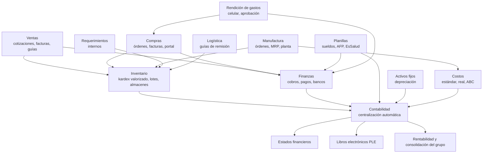
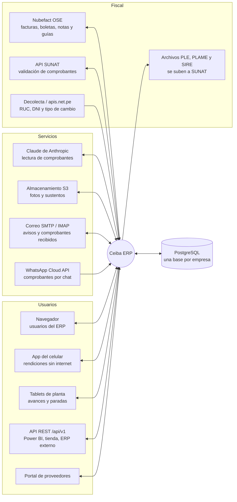
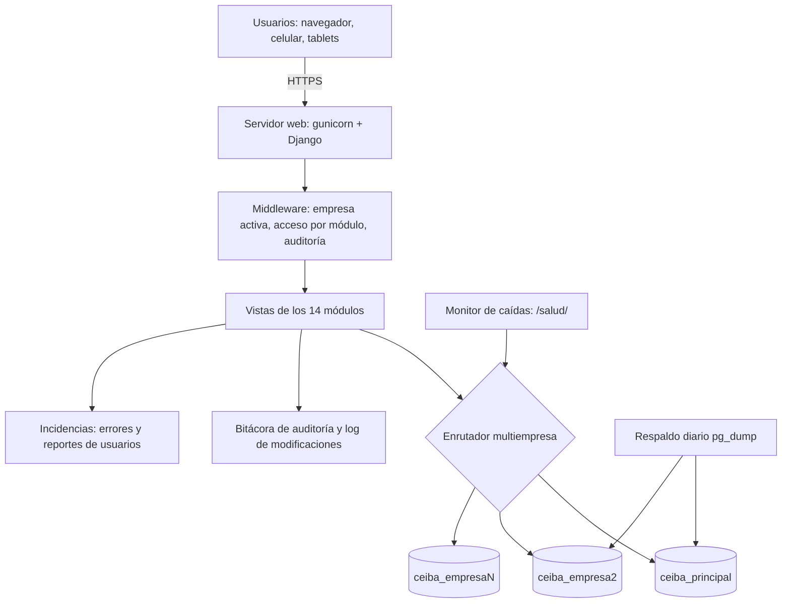

# Integración de Ceiba ERP

Cómo se conectan los módulos entre sí y con los servicios externos (versión 1.33.0). GitHub dibuja los diagramas.

## 1. Flujo de información entre módulos

Cada documento operativo mueve el inventario o el dinero y termina, sin digitar de nuevo, en un asiento contable.

| Origen | Qué genera | Destino |
|---|---|---|
| Ventas | Salida de stock (kardex), cuenta por cobrar, asiento de venta | Inventario, Finanzas, Contabilidad |
| Compras | Ingreso de stock al costo de la factura, cuenta por pagar, asiento de compra | Inventario, Finanzas, Contabilidad |
| Manufactura | Consumo de insumos, ingreso del producto con su lote, costo de la orden | Inventario, Costos, Contabilidad |
| Requerimientos | Salida de almacén cargada al centro de costo del área | Inventario, Contabilidad |
| Logística | Guía electrónica que acompaña la salida | Inventario, SUNAT |
| Planillas | Pago de sueldos y obligaciones, asiento de planilla | Finanzas, Contabilidad |
| Rendición de gastos | Facturas al registro de compras, reembolso o devolución del saldo | Compras, Finanzas, Contabilidad |
| Activos fijos | Depreciación mensual | Contabilidad |
| Finanzas | Cobros, pagos, retenciones, conciliación bancaria | Contabilidad |
| Costos | Liquidación del costo real del periodo y variaciones | Contabilidad |

## 2. Integraciones externas

| Servicio | Para qué | Dónde se configura | Código |
|---|---|---|---|
| Nubefact (OSE) | Emitir facturas, boletas, notas y guías electrónicas; recibir CDR | Ajustes › Facturación electrónica | `core/sunat.py` |
| API de SUNAT | Validar que un comprobante recibido existe y está activo | Ajustes › Facturación electrónica (client id/secret) | `core/sunat_consulta.py` |
| Decolecta / apis.net.pe | Datos del RUC/DNI y tipo de cambio SUNAT/SBS | Token en Rendiciones › Integraciones | `finanzas/comprobantes.py`, `core/tipo_cambio.py` |
| PLE, PLAME, SIRE | Libros electrónicos, planilla y cruce de compras (archivos) | Contabilidad, Planillas, Compras | `contabilidad/`, `planillas/`, `compras/` |
| Claude (Anthropic) | Leer datos de una foto de comprobante | Rendiciones › Integraciones (clave de API) | `finanzas/comprobantes.py` |
| Almacenamiento S3 | Guardar fotos y sustentos fuera de la base | Variables `OBJETOS_*` | `core/almacen_objetos.py` |
| Correo SMTP / IMAP | Avisos, órdenes de compra, recordatorios; leer comprobantes enviados por correo | Ajustes › Correo saliente; Rendiciones › Integraciones | `core/correo.py`, `leer_correo_rendiciones` |
| WhatsApp Cloud API | Recibir comprobantes por chat | Rendiciones › Integraciones | `finanzas/views_rendicion_movil.py` |
| API REST | Consultar y registrar desde otros sistemas (Power BI, tienda, ERP externo) | Menú del usuario › Claves de API | `core/views_api.py` |
| Portal de proveedores | Proveedores cargan facturas y aceptan órdenes | Compras › Portal | `proveedores/` |

## 3. Plataforma

- **Multiempresa**: cada empresa tiene su propia base PostgreSQL (datos, usuarios y configuración separados); la sesión indica cuál se usa y el enrutador manda ahí cada consulta (`erp/empresas.py`).
- **Seguridad**: acceso por módulo y por acción (`core/permisos.py`), segregación de funciones, doble factor, bitácora de cada cambio.
- **Monitoreo**: `/salud/` para un monitor de caídas, errores registrados como incidencias con aviso por correo, `logs/errores.log`.
- **Respaldos**: `scripts/respaldar_postgres.ps1` (programable con `scripts/programar_respaldo.ps1`). Detalle en [POSTGRESQL.md](POSTGRESQL.md).
- **Pruebas**: en cada subida a GitHub, todas las pruebas corren sobre PostgreSQL 17 (`.github/workflows/pruebas.yml`).
